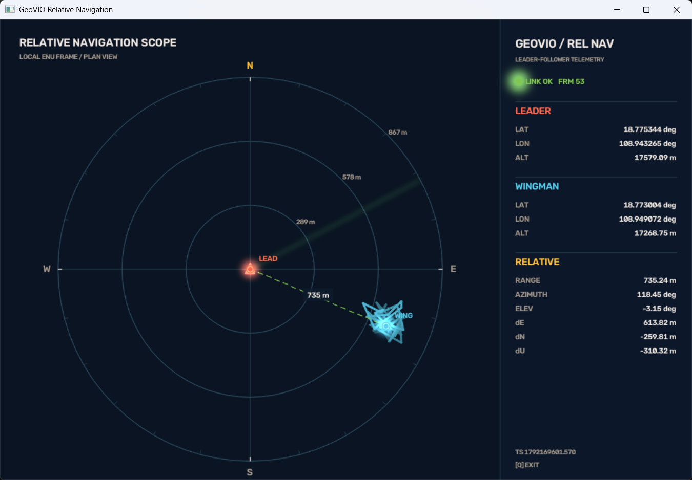

# 相对导航仿真（relative_navi）

主从双机 TCP 通信仿真：主机 `server.py` 循环广播自身 ECEF 轨迹位置，从机 `client.py` 接收后按相对量测（距离 / 方位角 / 仰角）解算僚机绝对位置，并实时渲染雷达态势图与遥测面板。

## 工作原理

```
主机 (server.py, :50007)
  enu_datum.txt + traj_esekf_out_f1.txt
      → ENU → ECEF 转换
      → 每 0.5 s 发送一行 JSON: {"timestamp": t, "position": [x, y, z]}

从机 (client.py)
      → 接收主机 ECEF 位置
      → relative_to_ecef(): 以主机为原点建立 ENU 系，
        按随机距离(600-800 m)/方位角(110-120°)/仰角(±10°) 构造僚机偏移 → ECEF
      → OpenCV 可视化 + 日志输出
```

## 部署步骤

1. **环境**：主从两台机器分别创建相同的 conda 虚拟环境并激活，执行 `pip install -r requirements.txt`；
2. **网络**：配置局域网，保证主从机器能互相 ping 通，防火墙放行 `50007` 端口；
3. **数据**：检查主机 `server.py` 开头两个数据文件路径：`enu_datum.txt`（ENU 基准点 `lat lon h`）与 `traj_esekf_out_f1.txt`（轨迹，每行 `timestamp x y z qx qy qz qw`）；
4. **地址**：修改 `client.py` 中 `SERVER_IP` 为主机实际局域网 IP；
5. **启动**：先启动主机 `python server.py`，再启动从机 `python client.py`；终端打印坐标日志，OpenCV 窗口显示可视化。

## 可视化界面

从机窗口（1080×720，`GeoVIO Relative Navigation`）由两部分组成：



**左侧 · 雷达态势图（RELATIVE NAVIGATION SCOPE）**

- 长机居中（橙色三角机标），僚机按真实相对偏移显示（青色三角机标，机头指向方位角）；
- 三道自适应量程距离环（带米数标注）+ 15° 刻度外圈 + N/E/S/W 方位字母 + 旋转扫描线；
- 僚机相对轨迹以渐隐折线留存（最多 160 帧）；
- 长-僚虚线连线，中点标注实时 3D 距离。

**右侧 · 遥测面板（LEADER-FOLLOWER TELEMETRY）**

- `LINK OK / FRM n`：链路状态与接收帧计数；
- `LEADER` / `WINGMAN`：两机经纬度与海拔（WGS-84）；
- `RELATIVE`：RANGE（3D 距离）、AZIMUTH、ELEV、ΔE/ΔN/ΔU（ENU 分量，米）；
- 底部：数据时间戳与 `[Q] EXIT` 提示。

退出方式：窗口内按 `q` 断开连接并关闭窗口；终端按 `Ctrl+C` 直接终止进程（两端均已捕获 `KeyboardInterrupt` 优雅退出）。

## 常见问题

| 现象 | 处理 |
| ---- | ---- |
| client 报 `无法连接` | 检查 `SERVER_IP` 是否为主机 IP、主机 server 是否已启动、防火墙是否放行 50007 |
| `cv2.imshow` 报 "function is not implemented" | 环境里同时装了 `opencv-python-headless`（无 GUI）。执行 `pip uninstall opencv-python-headless` 后 `pip install opencv-python` |
| 画面无僚机/超出画面 | 量程自适应，僚机距离增大时距离环自动扩大；检查 server 数据是否更新 |
| server 读文件失败 | 确认 `enu_datum.txt`、`traj_esekf_out_f1.txt` 与 `server.py` 同目录，字段为 `lat lon h` / `t x y z qx qy qz qw` |

